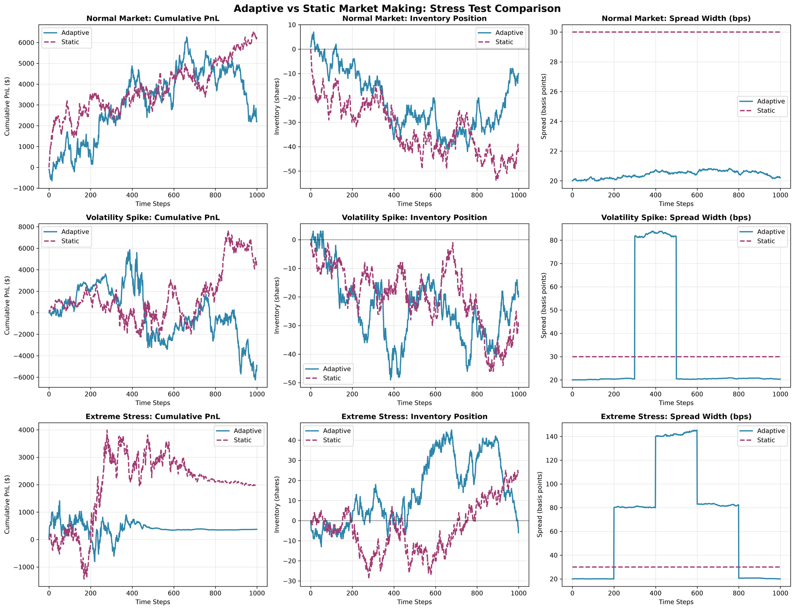
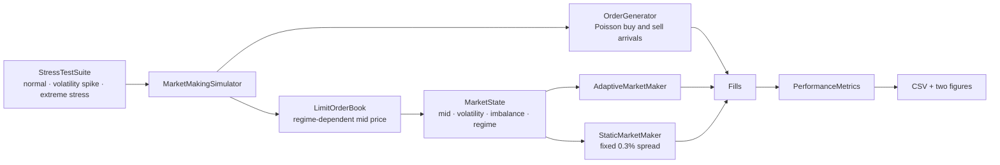
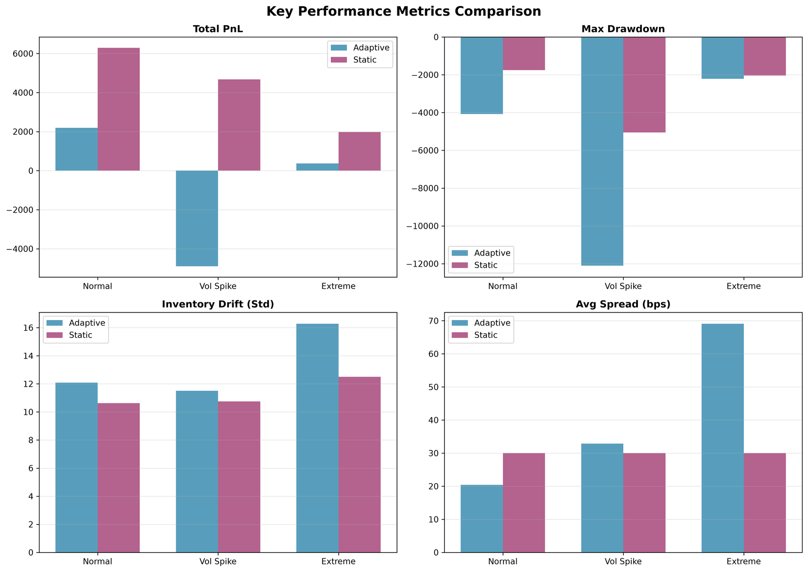

# Adaptive Market-Making Simulator

A limit order book simulation that measures what an adaptive spread buys a market maker when volatility jumps, and what it costs.




## Problem

A market maker quoting a fixed spread earns steadily in calm markets and is badly exposed when volatility
spikes: it keeps quoting tight while the price moves through its inventory. Widening the spread reduces
that exposure but gives up fills. The question is how much variance an adaptive quoter removes, and how
much return it gives up to do it.

## Approach

One Python file simulates a synthetic limit order book and runs two strategies through the same three
scenarios, 1,000 steps each, with a fixed seed.



- **Market.** The mid price moves with regime-dependent volatility (normal, high, extreme) on a schedule
  set by the scenario. Orders arrive as Poisson processes; the base rate of 5.0 is scaled by 1.0, 1.5 and
  2.0 across regimes and biased by order-flow imbalance.
- **Adaptive quoter.** Base spread of 0.2% of mid, widened by a realised-volatility multiplier, shifted by
  an inventory penalty and skewed by order-flow imbalance. Inventory limit 100, quote size 10.
- **Baseline.** A fixed 0.3% spread with the same inventory limit and size.
- **Metrics.** Total PnL, Sharpe ratio, max drawdown, inventory drift, average absolute inventory, average
  spread, fill count and PnL volatility, per scenario and strategy.

## Results

From `strategy_comparison_full.csv` (seed 42). A fresh run reproduces these numbers.

| Scenario | Metric | Adaptive | Fixed | Change |
|---|---|---|---|---|
| Extreme stress | PnL volatility | 74.63 | 116.44 | **-35.9%** |
| Extreme stress | Average spread (bps) | 69.12 | 30.00 | +130.4% |
| Extreme stress | Total PnL | 374.07 | 1,974.99 | -81.1% |
| Volatility spike | PnL volatility | 278.71 | 257.29 | +8.3% |
| Volatility spike | Total PnL | -4,894.26 | 4,671.17 | -204.8% |
| Normal market | PnL volatility | 139.07 | 111.31 | +24.9% |
| Normal market | Total PnL | 2,193.22 | 6,288.51 | -65.1% |

The adaptive quoter cut PnL volatility by 35.9% in the extreme-stress scenario by widening its spread to
more than twice the baseline. It paid for that in return: total PnL and Sharpe ratio were lower than the
fixed spread in all three scenarios, and in the normal and volatility-spike scenarios its PnL volatility
was higher. With these parameters the adaptive policy is a variance hedge for the extreme regime, not a
better strategy overall. The parameters are untuned.



## Quick start

```bash
git clone https://github.com/samarthpaliwal/adaptive-market-making-simulator.git
cd adaptive-market-making-simulator
pip install -r requirements.txt
python adaptive_market_making_simulator.py
```

The run takes a few seconds, prints a comparison table per scenario and writes three files to the current
directory: `strategy_comparison.csv`, `market_making_comparison.png` and
`performance_metrics_comparison.png`. On a machine with no display, set `MPLBACKEND=Agg`.

To experiment, change the attributes set in the strategy constructors (`base_spread`,
`volatility_spread_multiplier`, `inventory_penalty`, `imbalance_sensitivity`, `max_inventory`),
`OrderGenerator.base_arrival_rate`, or the `duration` passed to `StressTestSuite.run_all_scenarios`.

## Tech stack

Python, NumPy, pandas, Matplotlib.

## Project structure

```
adaptive-market-making-simulator/
├── adaptive_market_making_simulator.py   environment, strategies, simulator, metrics, plots, main()
├── strategy_comparison_full.csv          reference output of a run with seed 42
├── docs/                                 the two figures a run produces
├── requirements.txt
└── LICENSE
```
